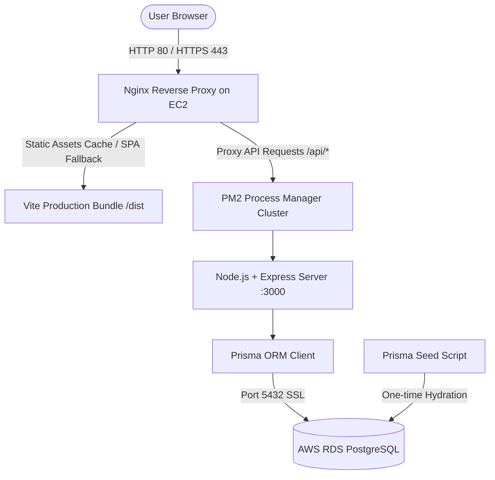

# Implementation Plan: AWS EC2 & RDS Production Deployment for NASH CMMS

This plan establishes an end-to-end production deployment configuration for **NASH CMMS** hosted on an **AWS EC2 instance (Ubuntu 24.04 LTS)** connected to **AWS RDS PostgreSQL**, preloaded with realistic industrial maintenance demo data.

---

## User Review Required

> [!IMPORTANT]
> **EC2 Key Pair (`QQQPS.pem`)**: We detected `QQQPS.pem` in the root workspace directory. The runbook provides exact PowerShell (Windows) and Bash commands to connect to the EC2 instance using this key.
>
> **AWS RDS Connection**: In the `.env` configuration, you will supply your RDS endpoint, username, and password:
> `DATABASE_URL="postgresql://<USER>:<PASSWORD>@<RDS_ENDPOINT>:5432/<DB_NAME>?schema=public&sslmode=require"`

---

## Proposed Architectural Components

---

## Proposed Changes

### 1. Database & ORM Layer (`prisma/`)

#### [MODIFY] [schema.prisma](file:///g:/oooo%20%D8%B3%D9%8A%D8%B1%D9%81%D8%B1/prisma/schema.prisma)
- Update and complete models to cover 100% of the mock data:
  - `User`, `Location`, `Category`, `Asset`, `WorkOrder`, `WorkOrderTask`, `LaborLog`, `AdditionalCost`, `Part`, `WorkOrderPart`, `PreventiveMaintenance`, `Meter`, `Vendor`, `Comment`.
  - Add missing models: `MaintenanceRequest` and `SystemSetting`.
  - Add required relational IDs, foreign keys, cascades, and indexes.

#### [NEW] [seed.ts](file:///g:/oooo%20%D8%B3%D9%8A%D8%B1%D9%81%D8%B1/prisma/seed.ts)
- Comprehensive seeding script ingesting the full dataset from `src/data/mockData.ts`:
  - **10 Work Orders** with nested tasks, labor logs, additional costs, parts used, and comments.
  - **10 Industrial Equipment Assets** (Carrier chillers, Caterpillar generators, Atlas Copco compressors, Komatsu presses, etc.).
  - **6 Locations** (Warehouse A, Main Building, Production Floor, Data Center Annex, Chemical Vault, Loading Docks).
  - **10 Parts & Inventory items** with unit costs, barcodes, and stock levels.
  - **8 Preventive Maintenance Triggers** with recurring schedules and priority levels.
  - **6 Users** (Administrators, Technicians, Managers) with hourly rates and roles.
  - **6 Industrial Vendors** (Apex Supply, Reliable HVAC, Motion Industries, Johnson Controls, Atlas Copco, Grainger).
  - **6 Maintenance Requests** and **5 Telemetry Meters**.
  - **System Settings** (language, currency, brand color, date format).
- Uses `upsert` so seeding is safe to run multiple times without duplicate key collisions.

---

### 2. Backend Server (`server/`)

#### [NEW] [tsconfig.server.json](file:///g:/oooo%20%D8%B3%D9%8A%D8%B1%D9%81%D8%B1/tsconfig.server.json)
- Dedicated TypeScript configuration to compile the Express backend into `server/dist/`.

#### [NEW] [index.ts](file:///g:/oooo%20%D8%B3%D9%8A%D8%B1%D9%81%D8%B1/server/index.ts)
- Modular Node.js / Express server:
  - Configures CORS, JSON parsing, URL encoding, request logging.
  - **REST API Endpoints**:
    - `GET /api/health`: Healthcheck endpoint with database ping (`SELECT 1`), uptime, and memory statistics.
    - CRUD endpoints for Work Orders, Assets, PMs, Parts, Locations, Categories, Users, Vendors, Meters, Requests, Settings.
  - **Production Static File Serving**: Serves the Vite production bundle (`dist/`) and handles SPA fallback (`index.html`).
  - Graceful shutdown handlers for `SIGTERM` and `SIGINT` with Prisma disconnection.

---

### 3. Production Process & Reverse Proxy (`deploy/`)

#### [NEW] [ecosystem.config.cjs](file:///g:/oooo%20%D8%B3%D9%8A%D8%B1%D9%81%D8%B1/ecosystem.config.cjs)
- PM2 configuration for cluster mode:
  - Automatic restart on failure or high memory threshold (`max_memory_restart: '500M'`).
  - Log rotation and timestamped logging (`logs/pm2-out.log`, `logs/pm2-error.log`).
  - Production environment variables (`NODE_ENV=production`, `PORT=3000`).

#### [NEW] [nash-cmms.conf](file:///g:/oooo%20%D8%B3%D9%8A%D8%B1%D9%81%D8%B1/deploy/nginx/nash-cmms.conf)
- Nginx configuration:
  - Reverse proxy to Node.js backend on `127.0.0.1:3000`.
  - Static asset caching (`/assets/` cache-control 1 year immutable).
  - Gzip compression for text, css, js, json, svg.
  - SPA fallback: `try_files $uri $uri/ /index.html;`.
  - Security headers and file upload body size limits (`client_max_body_size 25M`).

---

### 4. Configuration & Runbook

#### [MODIFY] [package.json](file:///g:/oooo%20%D8%B3%D9%8A%D8%B1%D9%81%D8%B1/package.json)
- Add dependencies: `@prisma/client`, `express`, `cors`, `dotenv`.
- Add devDependencies: `prisma`, `tsx`, `@types/express`, `@types/cors`.
- Add scripts for database migration, seeding, server dev/build/start.
- Configure `"prisma": { "seed": "tsx prisma/seed.ts" }`.

#### [NEW] [.env.example](file:///g:/oooo%20%D8%B3%D9%8A%D8%B1%D9%81%D8%B1/.env.example)
- Production environment template containing `DATABASE_URL`, `PORT`, `NODE_ENV`.

#### [NEW] [AWS_DEPLOYMENT_RUNBOOK.md](file:///g:/oooo%20%D8%B3%D9%8A%D8%B1%D9%81%D8%B1/AWS_DEPLOYMENT_RUNBOOK.md)
- Complete step-by-step terminal commands for Ubuntu 24.04 LTS:
  - Connecting with `QQQPS.pem` (Windows & Linux instructions).
  - Installing Node.js 20 LTS, npm, PM2, Nginx, Git, PostgreSQL client.
  - Setting up the codebase on `/var/www/nash-cmms`.
  - Creating `.env` pointing to AWS RDS PostgreSQL.
  - Running `npm install`, `npx prisma db push`, and `npx prisma db seed`.
  - Building Vite frontend & backend.
  - Starting PM2 and activating systemd startup hook.
  - Configuring and testing Nginx.
  - AWS Security Groups configuration (EC2 ports 22, 80, 443; RDS port 5432 restricted to EC2 SG).
  - Let's Encrypt SSL configuration with Certbot.
  - Health checks and troubleshooting guide.

---

## Verification Plan

### Automated / Local Verification
- `npm run build`: Verify that Vite frontend compiles without errors.
- `npx tsc -p tsconfig.server.json --noEmit`: Verify Express server and seed scripts compile without TypeScript errors.
- Validate JSON and configuration syntax (`ecosystem.config.cjs`, `nash-cmms.conf`, `schema.prisma`).

### Manual / Production Deployment Verification
- Verify EC2 SSH connectivity using `QQQPS.pem`.
- Test `/api/health` endpoint returning `{ status: "ok", db: "connected" }`.
- Test Nginx reverse proxy serving the React SPA and routing `/api/*` to Node.
- Verify PostgreSQL contains all 10 Work Orders and related assets via `npx prisma studio` or `psql`.
