# Implementation Plan: NASH CMMS Full-Stack Reverse-Engineering & Production Clone

Comprehensive technical specification and execution blueprint to reverse-engineer and clone **Atlas CMMS** (`https://app.atlas-cmms.com/`) into a modern, enterprise-grade application branded as **"NASH"**.

---

## 1. Executive Summary & Telemetry Findings

From our recursive deep browser telemetry and DOM inspection of the live Atlas CMMS instance, we captured the entire information architecture, database entities, component hierarchy, form controls, and design system variables.

### Target vs. Rebranded Identity
| Property | Target Application (Atlas CMMS) | Rebranded Application (NASH CMMS) |
| :--- | :--- | :--- |
| **Brand Name** | Atlas CMMS (Powered by Intelloop) | **NASH CMMS** |
| **Primary Accent Color** | Enterprise Blue (`#1975FF` / `#3B82F6`) | **Elevated Electric Teal / Deep Indigo (`#0EA5E9` / `#0284C7` & `#4F46E5`)** |
| **Sidebar Theme** | Dark Navy (`#0B132B` / `#0E1726`) | **Modernized Obsidian Navy (`#090D16` / `#0F172A`)** |
| **Surface & Neutral** | Light Slate (`#F8FAFC` / `#FFFFFF`) | **Refined Clean Slate (`#F8FAFC` / Glassmorphism `#FFFFFF`)** |
| **Status Accents** | Orange (Hold), Green (In Progress), Red (High) | **WCAG AA Compliant Emerald, Amber, Crimson, Azure** |

---

## 2. Reverse-Engineered Route & Module Inventory Map

The application consists of 14 primary operational modules:

```mermaid
graph TD
    App[NASH CMMS Core] --> WO[Work Orders /app/work-orders]
    App --> PM[Preventive Maintenance /app/preventive-maintenances]
    App --> Stats[Statistics & Analytics /app/statistics/*]
    App --> Req[Requests /app/requests]
    App --> Assets[Assets Inventory /app/assets]
    App --> Loc[Locations /app/locations]
    App --> Parts[Parts & Inventory /app/parts-inventory/*]
    App --> PR[Purchase Requests /app/purchase-orders]
    App --> Meters[Meters & Telemetry /app/meters]
    App --> People[People & Teams /app/people-teams/*]
    App --> Vendors[Vendors & Contractors /app/vendors-customers/*]
    App --> Cat[Categories /app/categories]
    App --> Files[File Repository /app/files]
    App --> Settings[System Settings /app/settings]

    WO --> WOCreate[Modal: Add Work Order]
    WO --> WODetail[Drawer: Work Order Details & Time Log]
    WO --> WOViews[Views: List, Calendar, Workload, Kanban]
```



### Module Specifications & Extracted Columns

1. **Work Orders (`/app/work-orders`)**:
   - **Views**: List View, Calendar View, Workload View, Column View (Kanban).
   - **Controls**: `+ Work Order` (Split dropdown), Quick Filters (Priority: *None, Low, Medium, High*; Status: *Open, In Progress, On Hold, Completed*), Search input.
   - **Grid Columns**: `ID`, `STATUS`, `TITLE`, `PRIORITY`, `DESCRIPTION`, `ASSIGNED TO`, `LOCATION NAME`, `LOCATION ADDRESS`, `CATEGORY`, `ASSET`.
   - **Slide-Over Detail Drawer**: Details tab, Comments tab, Live timer widget (`Run Timer 0:00`), Labors / Time Logs, Additional Costs, Parts & Materials, Linked Work Orders, Files.
   - **Creation Modal**: Title*, Description, Image upload dropzone, Location picker, Asset picker, Asset status, Due Date picker, Expected start date, Estimated duration, Category, Primary worker, Additional workers, Contractors, Teams, Tasks/Checklists, Required signature toggle.

2. **Preventive Maintenance (`/app/preventive-maintenances`)**:
   - **Controls**: `+ Create Trigger`, Search, Priority filter.
   - **Grid Columns**: `ID`, `NAME`, `WORK ORDER TITLE`, `PRIORITY`, `DESCRIPTION`, `NEXT WORK ORDER`, `WORKER`, `ASSIGNED TO`, `LOCATION NAME`, `CATEGORY`.

3. **Assets (`/app/assets`)**:
   - **Controls**: `+ Asset`, Search, Status filters.
   - **Grid Columns**: `ID`, `NAME`, `STATUS` (*Operational, Down, Emergency Shutdown*), `LOCATION`, `IMAGE`, `AREA`, `MODEL`, `BARCODE`, `CATEGORY`, `DESCRIPTION`, `PRIMARY WORKER`.

4. **Locations (`/app/locations`)**:
   - **Controls**: `+ Location`, Search.
   - **Grid Columns**: `NAME`, `ADDRESS`, `DESCRIPTION`, `CREATED BY`, `DATE CREATED`.

5. **Parts & Inventory (`/app/parts-inventory/parts` & `/purchase-orders`)**:
   - **Tabs**: Parts, Sets Of Parts.
   - **Grid Columns**: `NAME`, `COST`, `QUANTITY`, `BARCODE`, `AREA`, `CATEGORY`, `DESCRIPTION`, `ASSIGNED TO`, `DATE CREATED`.

6. **Requests (`/app/requests`)**:
   - **Controls**: `+ Request`, Search, Status filters.
   - **Grid Columns**: `TITLE`, `PRIORITY`, `STATUS`, `LOCATION`, `ASSET`, `CREATED BY`, `DATE CREATED`.

7. **Meters (`/app/meters`)**:
   - **Controls**: `+ Meter`, Search.
   - **Grid Columns**: `NAME`, `NEXT READING DUE`, `UNIT OF MEASUREMENT`, `LAST READING`, `LOCATION`, `ASSET`, `CREATED BY`, `DATE CREATED`.

8. **People & Teams (`/app/people-teams/people` & `/teams`)**:
   - **Grid Columns**: `NAME`, `EMAIL ADDRESS`, `PHONE`, `JOB TITLE`, `ROLE`, `HOURLY RATE`, `SCHEDULED`, `LAST LOGIN`, `ACTIONS`.

9. **Vendors & Contractors (`/app/vendors-customers/vendors` & `/customers`)**:
   - **Grid Columns**: `COMPANY NAME`, `ADDRESS`, `PHONE`, `WEBSITE`, `NAME`, `EMAIL ADDRESS`, `VENDOR TYPE`, `DESCRIPTION`, `HOURLY RATE`.

10. **Categories (`/app/categories`)**:
    - **Tabs**: Work Orders, Assets, Meters, Timers, Costs, Parts, Purchase Requests.

11. **Settings (`/app/settings`)**:
    - **Tabs**: General Settings, Features, Roles, Checklists, Integrations.
    - **Fields**: Language, Date format, Time zone, Currency, Pre-work order notification lead time, CSV separator, Brand color (`#1975ff` -> configurable NASH token), Demo data management.

---

## 3. Normalized Data Models (Prisma & TypeScript)

Extracted directly from the intercepted schemas and DOM states:

```typescript
// Core Enums
export type WorkOrderStatus = 'OPEN' | 'IN_PROGRESS' | 'ON_HOLD' | 'COMPLETED' | 'CANCELLED';
export type Priority = 'NONE' | 'LOW' | 'MEDIUM' | 'HIGH' | 'CRITICAL';
export type AssetStatus = 'OPERATIONAL' | 'DOWN' | 'EMERGENCY_SHUTDOWN' | 'IN_STORAGE';

// Work Order Model
export interface WorkOrder {
  id: string; // e.g. "WO000001"
  title: string;
  description?: string;
  status: WorkOrderStatus;
  priority: Priority;
  imageUrl?: string;
  locationId?: string;
  locationName?: string;
  assetId?: string;
  assetName?: string;
  assetStatus?: AssetStatus;
  dueDate?: string;
  expectedStartDate?: string;
  estimatedDurationHours?: number;
  categoryId?: string;
  categoryName?: string;
  assignedToId?: string;
  assignedToName?: string;
  assignedToAvatar?: string;
  createdById: string;
  createdByName: string;
  createdAt: string;
  updatedAt: string;
  requiresSignature: boolean;
  laborLogs: LaborLog[];
  additionalCosts: AdditionalCost[];
  partsUsed: PartUsage[];
  tasks: TaskItem[];
  comments: CommentItem[];
}

export interface Asset {
  id: string;
  name: string;
  status: AssetStatus;
  locationId: string;
  locationName: string;
  category: string;
  model?: string;
  serialNumber?: string;
  barcode?: string;
  description?: string;
  imageUrl?: string;
  primaryWorker?: string;
  createdAt: string;
}

export interface Part {
  id: string;
  name: string;
  cost: number;
  quantity: number;
  minQuantity: number;
  barcode?: string;
  area?: string;
  category: string;
  description?: string;
  assignedTo?: string;
  createdAt: string;
}

export interface PreventiveMaintenance {
  id: string;
  name: string;
  workOrderTitle: string;
  priority: Priority;
  description?: string;
  scheduleRule: string; // e.g. "Every 3 months"
  nextDueDate: string;
  assignedTo?: string;
  locationName: string;
  category: string;
  assetId?: string;
}
```

---

## 4. Rebranded Design System & Tokens (NASH)

### Modernized Palette Tokens
```css
:root {
  /* Brand Accents - Rebranded from Atlas #1975ff */
  --nash-primary: #0ea5e9;         /* Vibrant Electric Teal/Cyan */
  --nash-primary-hover: #0284c7;
  --nash-primary-muted: #e0f2fe;
  --nash-accent: #4f46e5;          /* Modern Indigo Accent */

  /* Neutral & Surfaces */
  --nash-bg-app: #f8fafc;          /* Slate 50 */
  --nash-bg-card: #ffffff;
  --nash-border: #e2e8f0;          /* Slate 200 */
  --nash-border-strong: #cbd5e1;   /* Slate 300 */
  --nash-text-primary: #0f172a;    /* Slate 900 */
  --nash-text-secondary: #64748b;  /* Slate 500 */
  --nash-text-muted: #94a3b8;      /* Slate 400 */

  /* Sidebar Tokens */
  --nash-sidebar-bg: #090d16;      /* Ultra Dark Obsidian Navy */
  --nash-sidebar-hover: #1e293b;
  --nash-sidebar-active: #0ea5e9;
  --nash-sidebar-text: #94a3b8;
  --nash-sidebar-text-active: #ffffff;

  /* Status Colors (WCAG AA Compliant) */
  --nash-status-open: #3b82f6;
  --nash-status-open-bg: #dbeafe;
  --nash-status-progress: #10b981;
  --nash-status-progress-bg: #d1fae5;
  --nash-status-hold: #f59e0b;
  --nash-status-hold-bg: #fef3c7;
  --nash-status-danger: #ef4444;
  --nash-status-danger-bg: #fee2e2;

  /* Geometry & Elevation */
  --nash-radius-sm: 6px;
  --nash-radius-md: 8px;
  --nash-radius-lg: 12px;
  --nash-radius-xl: 16px;
  --nash-shadow-card: 0 1px 3px 0 rgb(0 0 0 / 0.08), 0 1px 2px -1px rgb(0 0 0 / 0.08);
  --nash-shadow-drawer: -4px 0 25px -5px rgb(0 0 0 / 0.15);
}
```

---

## 5. Implementation Roadmap & Deliverables

### Step 1: Project Architecture Setup
- Initialize modern Vite + React + TypeScript + Tailwind CSS application in the workspace root (`c:\Users\JOJO\Desktop\oooo`).
- Configure Lucide icons, date formatting, and custom color token configurations.
- Create modular SVG branding assets for **NASH** (Logo mark, typography, favicon).

### Step 2: Enterprise Shell & Layout
- Replicate the exact Atlas CMMS layout hierarchy branded as **NASH**:
  - **Left Sidebar**: NASH brand header, Trial/Business plan badge, all 14 navigation links with badges (Work Orders `1`, Requests `1`), expandable submenus for Statistics, Parts/Inventory, People & Teams, Vendors, bottom utility bar (export, help, calendar, logout).
  - **Global Topbar**: Collapse sidebar toggle, Route title with breadcrumb, Notification bell with live badge, User profile avatar menu with status indicator.

### Step 3: Work Orders Module (Exact Feature-for-Feature Clone)
- **View Switcher**: List View, Calendar View, Workload View, Column View (Kanban).
- **Interactive Action Bar**: Priority pills, Status pills, Live search bar, Column config menu, `+ Work Order` split button.
- **Data Grid**: Status badge with pulsing/colored dot, priority pill, assignee avatars, asset tag, responsive pagination with rows-per-page selector.
- **Full Slide-Over Detail Drawer**:
  - Header actions: Status dropdown, Run Timer button with real-time running stopwatch, Edit, Delete.
  - Tab navigation: `Details`, `Comments`.
  - Metadata cards: ID, Category, Location, Asset, Created At, Assigned To.
  - Interactive sub-sections: Labors / Add Time, Additional Costs, Parts / Add Parts with real-time cost calculation, Attachments.
- **Create Work Order Modal**:
  - Full form matching the captured Atlas CMMS drawer: Title*, Description, Drag & Drop Image Dropzone, Location selector, Asset selector, Asset status, Due Date picker, Category selector, Worker assignment, Tasks checklist builder, Signature required toggle.

### Step 4: Supporting Modules Scaffold & Navigation
- Provide high-fidelity screens for:
  - **Assets**: Operational, Down, Emergency Shutdown status badges, model/serial, barcode.
  - **Preventive Maintenance**: Triggers, recurring intervals, next work order dates.
  - **Parts & Inventory**: Stock quantities, costs, category tags, reorder levels.
  - **Settings**: General settings with customizable brand color token, localization, and "Delete demo data" action.

---

## 6. User Review Required

> [!IMPORTANT]
> The target application has been completely crawled and audited. All navigation routes, data fields, forms, drawers, and design variables have been captured.
> We are ready to generate the production-grade codebase for **NASH CMMS**.
> 
> Please review and approve the implementation plan so we can start generating the application in the workspace.

## 7. Verification Plan

### Automated Verification
- Run `npm run build` or `npx tsc` to ensure zero TypeScript errors and complete type safety.
- Verify clean compilation of Tailwind CSS and design tokens.

### Interactive Browser Verification
- Launch local development server (`npm run dev`) at `http://localhost:5173`.
- Launch browser subagent to verify:
  1. Complete navigation across Work Orders, Assets, PMs, Parts, and Settings.
  2. Clicking `+ Work Order` opens the creation modal with all validated fields.
  3. Clicking a work order row opens the slide-over detail drawer with the functional stopwatch timer and tabs.
  4. Brand substitution (NASH logo and typography) and elevated color palette render properly with zero console errors.
